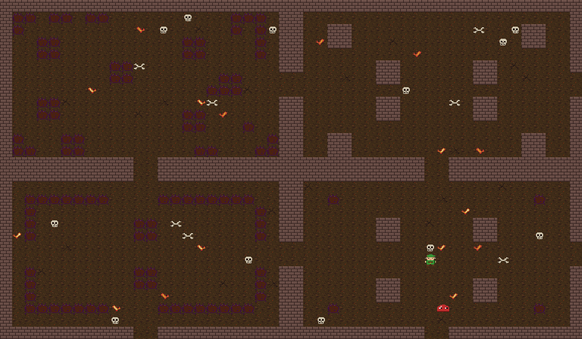

# Crystal Sword Quest — Top-Down Adventure Prototype

A small top-down action roguelike in the style of classic Zelda, built in Unity with the help of Claude. Explore a 3×3 world of screen-sized rooms, hunt for a hidden Crystal Sword, and defeat the boss in its lair. Then do it again, as the world grows more dangerous every level, until you fall.

*Above: the whole world as laid out in the editor, showing all five Crystal Sword nooks and the boss's starting point. In play, one nook is used per level and the boss moves to a random corner room. Below: part of the world at level 5, with scorched ground, thorn bushes, skulls, bones and glowing embers.*

All of the pixel art, sound effects and music are generated from code. There are no imported art or audio assets.

## Playing

1. Open the project in **Unity 6000.6.5f1** (or a compatible Unity 6 version).
2. Press **Play**. The game always starts from the title screen, whichever scene is open.

To jump straight into the game while testing, untick **Tools > Play From Title Screen**. Play then runs whichever scene is open, such as `SampleScene`.

### Title screen

| Option | What it does |
| --- | --- |
| **Play** | Starts the game |
| **Instructions** | The goal, controls and tips |
| **Options** | Music volume, sound volume, HUD size (80–130%) and fullscreen (fullscreen applies in builds). Saved between sessions |
| **Exit** | Quits the game (stops Play mode in the editor) |

Menus work with the keyboard (arrows / WASD, Enter, Esc to go back), a gamepad, or the mouse.

### Controls

| Action | Keyboard | Gamepad |
| --- | --- | --- |
| Move | WASD / Arrow keys | Left stick |
| Sword attack | Space / J | South button (A / Cross) |
| Pause menu (Resume / Quit to Title) | Esc | Start |

### Goal

Walk through doorways to explore the world and find the boss's lair. Each level the boss sets up in a random **corner room** (never next to the central starting room, and never the same corner twice in a row), and that room's regular monsters clear out. The minimap only marks the lair once you've found it. Beating the boss clears the level.

A **Crystal Sword** is hidden in one of five nooks around the world: a different one each level, and never in the boss's lair. It makes the boss much quicker to beat.

Each new level:
- **Hearts** refill, and you gain a heart container (up to 10). You start with 5.
- **Monsters** get faster, tougher, longer-sighted and harder-hitting. Slimes start chasing at level 3 and bats at level 4. Every room gets extra monsters (up to 3 more).
- **The boss** takes 2 more basic-sword hits (and 1 more Crystal Sword hit every other level), attacks faster and more often, fires more and faster fireballs, and hits harder.
- **The world** looks more dangerous and the music picks up a little:
  - **Level 2:** the land turns parched, and cracks and bones appear.
  - **Level 3:** a dusk tint; bushes wither into thorn bushes, and skulls appear.
  - **Level 4:** the grass is scorched, glowing ember cracks flicker, and the light dims.
  - **Level 5 and up:** a deepening blood-moon red, more debris, and darker light.

| Level | Boss hits (basic / Crystal Sword) |
| --- | --- |
| 1 | 10 / 3 |
| 2 | 12 / 3 |
| 3 | 14 / 4 |
| 4 | 16 / 4 |
| 5 | 18 / 5 |
| 6 | 20 / 5 |

**One life.** If your hearts run out, the run is over. The Game Over screen shows your level, kills, damage taken and score. Press Enter to start a new run from level 1, or Esc for the title screen. Quitting from the pause menu also ends the run.

### Scoring

**Score = (kill points × the level of each kill) − 100 for every heart of damage taken**, never below 0.

| Kill | Points (× level) |
| --- | --- |
| Slime | 100 |
| Bat | 150 |
| Moblin | 250 |
| Boss | 2,000 |

Your high score and best level are saved and shown in the HUD, on the Game Over screen and on the title screen.

## Features

- **Endless levels, roguelike style**: one life per run, rising difficulty, growing hearts, and a saved high score.
- **Title screen** with Play, Instructions, Options and Exit over an animated pixel-art backdrop, plus an in-game **pause menu**.
- **Screen-to-screen rooms**: nine rooms (woods, ruins, lake, hedge maze, starting clearing, moblin camp, graveyard, river crossing and the arena). The camera slides to the next room as you walk through a doorway, and only the current room's monsters are active. Monsters you leave alive return to their starting spots when you come back.
- **Boss fight**: a horned demon that stalks you, winds up and charges, and fires spreads of fireballs (you can slash them out of the air). Its lair moves to a random corner room each level, and it has its own unsettling music and a boss health bar.
- **Hidden Crystal Sword**: hidden in a different nook each level. It cuts the boss down in far fewer hits and does double damage to regular monsters.
- **Player** with four-direction movement, walk animations for each direction, and a sweeping sword arc. A slim, rounded collider lets you slide around corners and squeeze between obstacles.
- **Lightning bolt**: while you have at least half your hearts, every swing also fires a lightning bolt in the direction you're facing. It deals the same damage as the sword (including against the boss) and stops at walls and water. One bolt on screen at a time.
- **Crystal lightning**: with the Crystal Sword the bolt is bigger and crystal-blue, with a pulsing glow and an after-image trail. You can have two on screen at once, and they **burn through bushes** (which can open shortcuts until the next level).
- **Three monster types** (level 1 stats; they scale up every level)
  - **Slime** (red, 2 HP): wanders around.
  - **Bat** (purple, 1 HP): flutters erratically.
  - **Moblin** (orange, 3 HP): chases you when you get close.
- **Combat**: knockback, hit flashes and invulnerability frames.
- **Heart pickups** that monsters sometimes drop.
- **HUD**: the always-on HUD sits inside the room's wall rows, so it never covers the playing field. The top wall row holds the hearts and Crystal Sword icon (left) and a small Level / Score / Best line (right). The bottom wall row holds the boss health bar (center) and the minimap (right). Overlays include a level banner, pick-up messages, the pause menu, and the Level Clear and Game Over screens. They scale with the screen, and the HUD Size option makes them bigger or smaller.
- **Escalating landscape**: each level the world looks more dangerous, from parched ground and bones to thorn bushes, scorched earth, embers and a blood-moon red (see the level list above).
- **Audio**: chiptune sound effects, an original overworld theme, a separate boss theme, and menu sounds. An urgent **danger theme** takes over (even in the boss fight) when you drop below 25% health, and the right track returns once you heal. Volume levels come from the Options menu.

## Project layout

| Path | Contents |
| --- | --- |
| `Assets/Scripts/` | Gameplay: `PlayerController`, `PlayerAnimator`, `RoomManager`, `Enemy`, `Boss`, `Fireball`, `SpriteAnimator`, `SwordHitbox`, `SwordBeam`, `SwordPickup`, `Health`, `HeartPickup`, `GameHUD`, `AudioManager`. Levels and runs: `GameSession` (level, score, high score), `LevelDirector` (per-level landscape, boss lair, extra monsters, sword spot). Menus and settings: `TitleScreen`, `MenuInput`, `GameSettings` |
| `Assets/Editor/ZeldaBoardBuilder.cs` | Draws the pixel art and builds the world in the open scene (**Tools > Build Zelda Board**) |
| `Assets/Editor/TitleScreenBuilder.cs` | Builds the title scene (**Tools > Build Title Screen**) and puts it first in Build Settings |
| `Assets/Editor/ChiptuneSynth.cs` | Synthesizes the sound effects and music as WAV files |
| `Assets/Editor/PlayFromTitleScreen.cs` | Makes Play in the editor start from the title screen (**Tools > Play From Title Screen** to toggle) |
| `Assets/Scenes/TitleScreen.unity` | The title screen (first scene in the build) |
| `Assets/Scenes/SampleScene.unity` | The game world |
| `Assets/Art/` | Generated sprites and tiles |
| `Assets/Audio/` | Generated sound effects and music |
| `Assets/Prefabs/` | Heart pickup, boss fireball, sword lightning bolt and bush-fire prefabs |
| `Docs/` | README screenshots |

## Editing the game

### Rooms

Each room's layout is a text grid in the `Rooms` list in `Assets/Editor/ZeldaBoardBuilder.cs`. Each grid is the room's 22×12 interior. The outer walls are added automatically, with a doorway cut in the middle of each side that touches another room. The first 3 tiles inside every doorway are always kept clear, so anything placed there is replaced with grass.

| Character | Meaning |
| --- | --- |
| `#` | Wall |
| `b` | Bush |
| `w` | Water |
| `.` | Grass |
| `P` | Player start |
| `s` | Slime |
| `v` | Bat |
| `m` | Moblin |
| `B` | Boss starting point (the LevelDirector moves it to a random corner room each level; the lair gets the boss music) |
| `S` | Crystal Sword hiding spot (place several; one is picked at random each level) |

To change the world size, adjust `WorldRows` / `WorldCols` and add or remove room grids to match (listed row by row).

### Rebuilding

1. Open `SampleScene` and run **Tools > Build Zelda Board**. This regenerates the art, audio and world and saves the scene.
2. Run **Tools > Build Title Screen** to rebuild the title scene (it uses the generated art).

### Art, music and tuning

- **Sprites** are defined as text in `ZeldaBoardBuilder.cs`, one character per pixel, so you can redraw characters there.
- **Music**: edit the `Melody` / `Bass` (overworld), `BossMelody` / `BossBass` (boss) or `DangerMelody` / `DangerBass` (low health) note lists in `ChiptuneSynth.cs`, then rebuild.
- **Lightning and danger thresholds**: `beamHealthFraction` (0.5) and `dangerHealthFraction` (0.25) on the `PlayerController`.
- **Landscape stages**: `LevelDirector.ApplyLandscape` (tint, thorns, scorched ground, light) and `ScatterDecor` (cracks, bones, skulls, embers).
- **Boss difficulty**: the level-1 hit counts are `hitsWithBasicSword` and `hitsWithUpgradedSword` on the `Boss` component (set up in `CreateBoss` in the builder). Per-level increases are in `Boss.ApplyLevel`.
- **Monster scaling**: `Enemy.ApplyLevel` (speed, HP, damage, chase range, when wanderers start chasing). Extra monsters per room: `maxExtraMonstersPerRoom` on the `LevelDirector`.
- **Hearts and scoring**: `StartingHearts`, `MaxHeartsCap` and `DamagePenalty` in `GameSession`; kill points are `scoreValue` on each monster (set in the builder) and the boss.
- **Testing a level**: in the editor, `GameSession.SetLevelForTesting(n)` jumps to level `n`.
- **Game title**: the `gameTitle` field on the `TitleScreen` component.

## Tech

- Unity 6 with the Universal Render Pipeline (2D Renderer)
- Input System package
- Tilemaps with composite colliders for walls, bushes and water
- 2D global light (dimmed at higher levels)
- IMGUI for the HUD and menus
- Run state and high score kept in a static `GameSession` and `PlayerPrefs`
