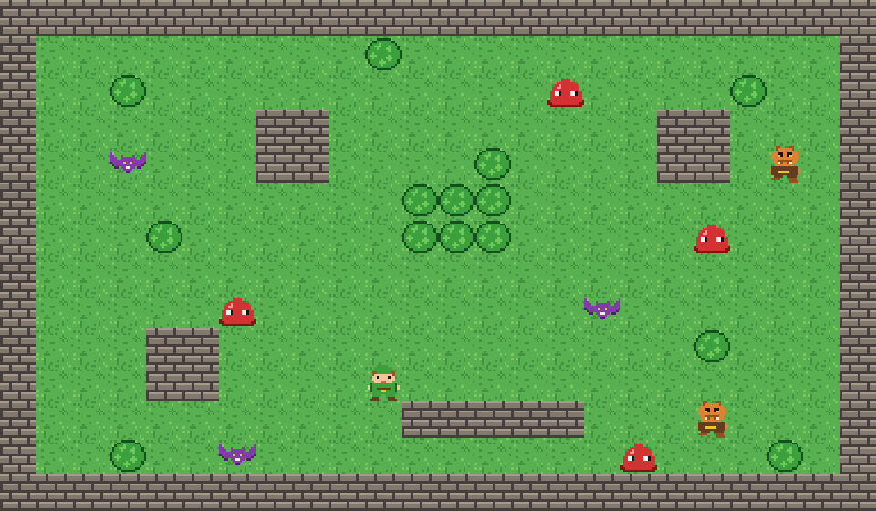

# Crystal Sword Quest — Top-Down Adventure Prototype

A small top-down action game in the style of classic Zelda, built in Unity with the help of Claude. Explore a 3×3 world of screen-sized rooms, hunt for a hidden Crystal Sword, and defeat the boss in its lair.

All of the pixel art, sound effects and music are generated from code. There are no imported art or audio assets.

## Playing

1. Open the project in **Unity 6000.6.5f1** (or a compatible Unity 6 version).
2. Open `Assets/Scenes/TitleScreen.unity` (or `SampleScene.unity` to jump straight into the game).
3. Press **Play**.

### Title screen

| Option | What it does |
| --- | --- |
| **Play** | Starts the game |
| **Instructions** | The goal, controls and tips |
| **Options** | Music volume, sound volume and fullscreen (fullscreen applies in builds). Saved between sessions |
| **Exit** | Quits the game (stops Play mode in the editor) |

Menus work with the keyboard (arrows / WASD, Enter, Esc to go back), a gamepad, or the mouse.

### Controls

| Action | Keyboard | Gamepad |
| --- | --- | --- |
| Move | WASD / Arrow keys | Left stick |
| Sword attack | Space / J | South button (A / Cross) |
| Pause menu (Resume / Quit to Title) | Esc | Start |

### Goal

Walk through doorways to explore the world. The boss waits in the bottom-right arena. It takes **10** sword hits to beat, or just **3** if you've found the **Crystal Sword** hidden somewhere in the world. Beating the boss wins the game; press Enter to play again or Esc to return to the title screen.

You have 5 hearts. If they run out, the game restarts.

## Features

- **Title screen** with Play, Instructions, Options and Exit over an animated pixel-art backdrop, plus an in-game **pause menu**.
- **Screen-to-screen rooms**: nine rooms (woods, ruins, lake, hedge maze, starting clearing, moblin camp, graveyard, river crossing and the boss arena). The camera slides to the next room as you walk through a doorway, and only the current room's monsters are active. Monsters you leave alive return to their starting spots when you come back.
- **Boss fight**: a horned demon that stalks you, winds up and charges, and fires spreads of fireballs (you can slash them out of the air). Its room has its own unsettling music and a boss health bar.
- **Hidden Crystal Sword**: cuts the boss down in 3 hits instead of 10 and does double damage to regular monsters.
- **Player** with four-direction movement, walk animations for each direction, and a sweeping sword arc.
- **Three monster types**
  - **Slime** (red, 2 HP): wanders around.
  - **Bat** (purple, 1 HP): flutters erratically.
  - **Moblin** (orange, 3 HP): chases you when you get close.
- **Combat**: knockback, hit flashes and invulnerability frames.
- **Heart pickups** that monsters sometimes drop.
- **HUD**: hearts, a Crystal Sword icon once you have it, a minimap (visited rooms, the boss room and your position), the boss health bar, and win / game-over screens.
- **Audio**: chiptune sound effects, an original overworld theme, a separate boss theme, and menu sounds. Volume levels come from the Options menu.

## Project layout

| Path | Contents |
| --- | --- |
| `Assets/Scripts/` | Gameplay: `PlayerController`, `PlayerAnimator`, `RoomManager`, `Enemy`, `Boss`, `Fireball`, `SpriteAnimator`, `SwordHitbox`, `SwordPickup`, `Health`, `HeartPickup`, `GameHUD`, `AudioManager`. Menus and settings: `TitleScreen`, `MenuInput`, `GameSettings` |
| `Assets/Editor/ZeldaBoardBuilder.cs` | Draws the pixel art and builds the world in the open scene (**Tools > Build Zelda Board**) |
| `Assets/Editor/TitleScreenBuilder.cs` | Builds the title scene (**Tools > Build Title Screen**) and puts it first in Build Settings |
| `Assets/Editor/ChiptuneSynth.cs` | Synthesizes the sound effects and music as WAV files |
| `Assets/Scenes/TitleScreen.unity` | The title screen (first scene in the build) |
| `Assets/Scenes/SampleScene.unity` | The game world |
| `Assets/Art/` | Generated sprites and tiles |
| `Assets/Audio/` | Generated sound effects and music |
| `Assets/Prefabs/` | Heart pickup and boss fireball prefabs |

## Editing the game

### Rooms

Each room's layout is a text grid in the `Rooms` list in `Assets/Editor/ZeldaBoardBuilder.cs`. Each grid is the room's 22×12 interior. The outer walls are added automatically, with a doorway cut in the middle of each side that touches another room. The first 3 tiles inside every doorway are always kept clear, so anything placed there is replaced with grass.

| Character | Meaning |
| --- | --- |
| `#` | Wall |
| `b` | Bush |
| `w` | Water |
| `.` | Grass |
| `P` | Player start |
| `s` | Slime |
| `v` | Bat |
| `m` | Moblin |
| `B` | Boss (its room gets the boss music) |
| `S` | Hidden Crystal Sword |

To change the world size, adjust `WorldRows` / `WorldCols` and add or remove room grids to match (listed row by row).

### Rebuilding

1. Open `SampleScene` and run **Tools > Build Zelda Board**. This regenerates the art, audio and world and saves the scene.
2. Run **Tools > Build Title Screen** to rebuild the title scene (it uses the generated art).

### Art, music and tuning

- **Sprites** are defined as text in `ZeldaBoardBuilder.cs`, one character per pixel, so you can redraw characters there.
- **Music**: edit the `Melody` / `Bass` (overworld) or `BossMelody` / `BossBass` note lists in `ChiptuneSynth.cs`, then rebuild.
- **Boss difficulty**: `hitsWithBasicSword` and `hitsWithUpgradedSword` on the `Boss` component (set up in `CreateBoss` in the builder).
- **Game title**: the `gameTitle` field on the `TitleScreen` component.

## Tech

- Unity 6 with the Universal Render Pipeline (2D Renderer)
- Input System package
- Tilemaps with composite colliders for walls, bushes and water
- IMGUI for the HUD and menus
